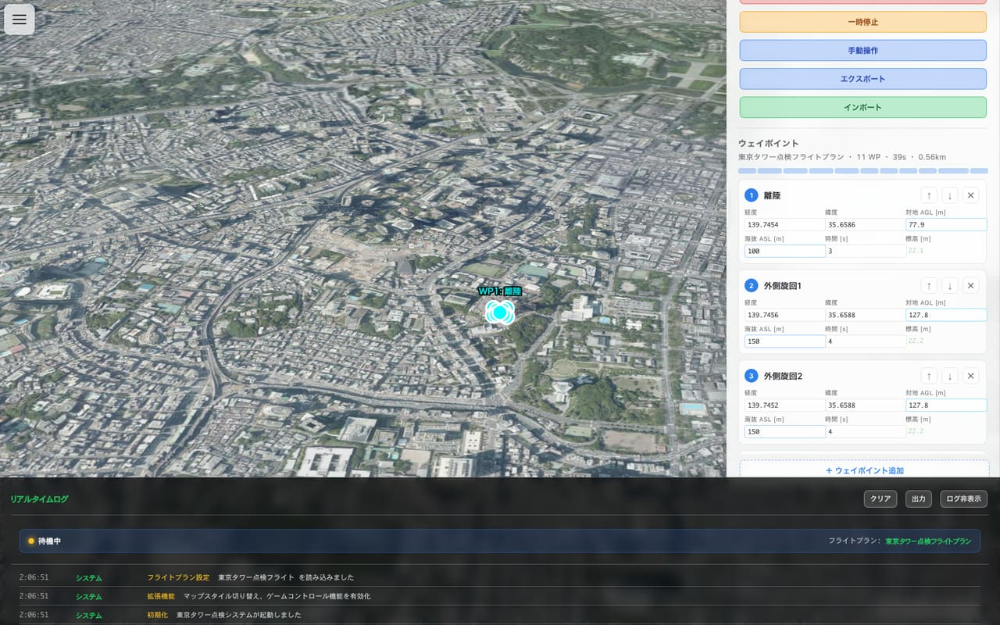

# gsi-terrain-flight-simulator

国土地理院の空中写真と標高データによる 3D 地形の上で、ドローンの飛行計画を作成・実行するブラウザアプリです。

> リポジトリ名は作業用の仮の名前です。

[](https://github.com/BoxPistols/gsi-terrain-flight-simulator/actions/workflows/ci.yml)



## 実行方法

Node.js 18 以上と pnpm が必要です。

```bash
pnpm install
pnpm dev        # http://localhost:5173
```

| コマンド | 内容 |
|---|---|
| `pnpm build` | `dist/` に本番用のファイルを出力 |
| `pnpm preview` | ビルド結果をローカルで表示 |
| `pnpm lint` / `pnpm type-check` / `pnpm format:check` | 静的検査 |
| `pnpm test:ci` | ユニットテスト（Vitest） |
| `pnpm test:e2e` | E2E テスト（Playwright・Chromium。ビルドしてから `vite preview` に対して実行。全ブラウザは `pnpm test:e2e:all-browsers`） |

## 構成

- 地図の描画: MapLibre GL JS（設定で Mapbox GL JS に切り替え可能。その場合は利用者自身のアクセストークンが必要）
- 地形: 標高タイル（地理院形式の PNG）を MapLibre が扱える形式に変換する [maplibre-gl-gsi-terrain](https://www.npmjs.com/package/maplibre-gl-gsi-terrain)（npm、`2.3.2` に固定）
- ビルド: Vite / テスト: Vitest・Playwright / CI: GitHub Actions

```
app/                 アプリ本体（index.html / index.ts / modules/ / data/）
src/                 データの読み込み・書き出し（data-import-export.ts）
tests/e2e/           Playwright の E2E テスト
docs/                マニュアルと改善計画
```

操作方法は [ユーザーマニュアル](./docs/USER_MANUAL.md)、内部構成は [開発者マニュアル](./docs/DEVELOPER_MANUAL.md) と [技術仕様](./docs/TECHNICAL_SPECIFICATION.md) を参照してください。

このアプリは [BoxPistols/maplibre-gl-gsi-terrain](https://github.com/BoxPistols/maplibre-gl-gsi-terrain) の `example/` から移したものです。移す前の履歴は `git log` で追えます。

## 不具合報告・提案

- 不具合の報告や機能の提案は [Issue](https://github.com/BoxPistols/gsi-terrain-flight-simulator/issues) で受け付けます
- コードのプルリクエストは受け付けていません（このリポジトリのコードは All rights reserved のため）

## ライセンス

- **このリポジトリのコード**: All rights reserved（© Ito Atsushi / BoxPistols）。GitHub 上での閲覧・参照は自由ですが、事前の書面による許可のない利用・複製・改変・再配布は禁止します。全文は [LICENSE](./LICENSE)、問い合わせは https://asagiri-design.carrd.co/ から
- **第三者のソフトウェアとデータ**（maplibre-gl-gsi-terrain、MapLibre GL JS、Mapbox GL JS、地理院タイル、産総研シームレス標高タイルなど）: それぞれの条件に従います。一覧は [NOTICE.md](./NOTICE.md)
